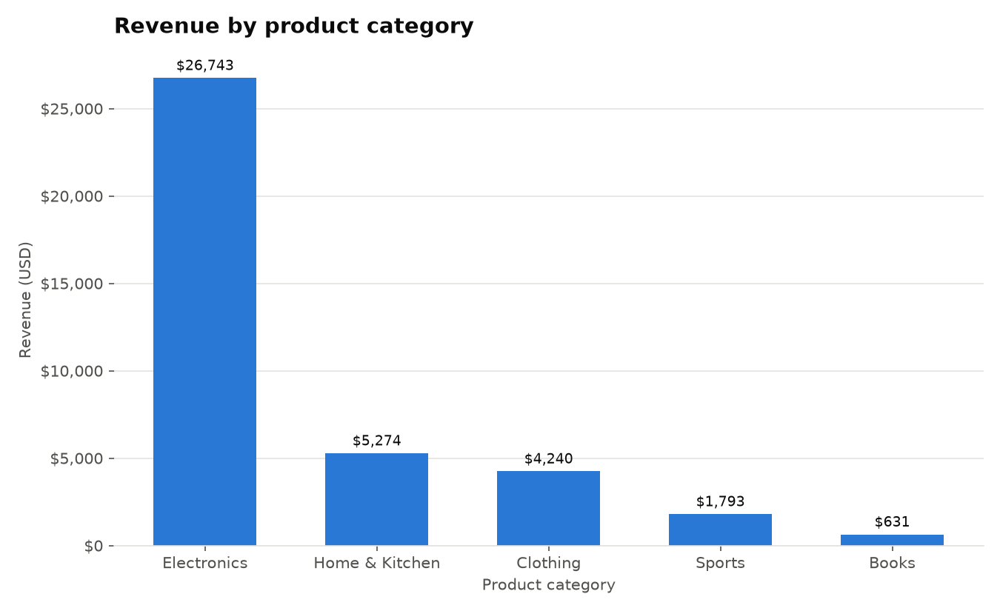
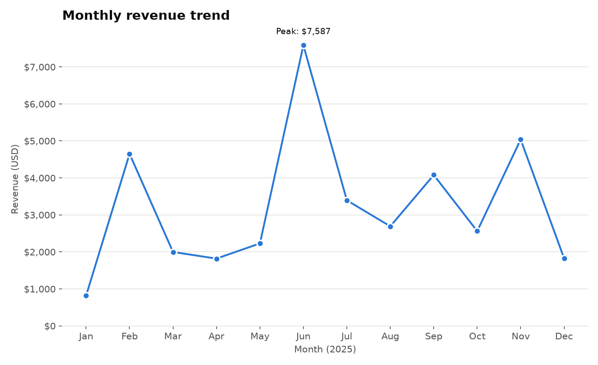
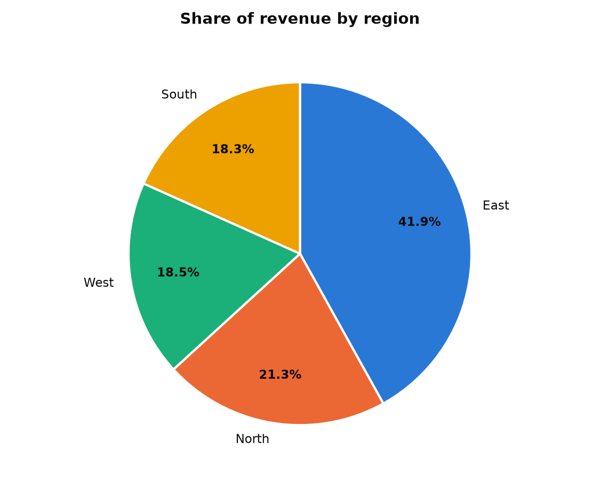

# E-commerce Sales Analysis Report

*Period: 16 Jan 2025 to 23 Dec 2025*

## 1. Data quality
- Rows loaded: **100**
- Duplicates removed: **2**
- Rows with missing values removed: **1**
- Rows with invalid quantity/price removed: **1**
- Rows analysed: **96**
- Text columns were trimmed and standardised (e.g. `books` -> `Books`).

## 2. Key metrics
| Metric | Value |
|---|---|
| Total revenue | $38,681.27 |
| Orders | 96 |
| Units sold | 319 |
| Average order value | $402.93 |

## 3. Revenue by category
| Category | Revenue | Share | Units |
|---|---|---|---|
| Electronics | $26,743 | 69.1% | 75 |
| Home & Kitchen | $5,274 | 13.6% | 69 |
| Clothing | $4,240 | 11.0% | 101 |
| Sports | $1,793 | 4.6% | 37 |
| Books | $631 | 1.6% | 37 |

## 4. Monthly trend

## 5. Regional split

## 6. Insights
1. **Electronics drives the business**: 69% of revenue ($26,743). The category with the most units is Clothing, so unit volume and revenue tell different stories.
2. **Revenue peaks in June** ($7,587) and is lowest in January ($816). Q4 (Oct-Dec) contributes 24% of revenue, close to an even 25% share, so there is no strong holiday lift in this data.
3. **Regional split:** East is the largest region at 42% of revenue, so sales lean noticeably on one market.
4. **Average order value is $402.93**, pulled up by high-priced categories; raising the basket size in low-priced categories is the cheapest growth lever.

## 7. Recommendations
- Protect stock and marketing budget for the top category and the peak month.
- Plan promotions for the weakest month to smooth out demand.
- Bundle low-priced items (e.g. Books) with higher-priced ones to lift average order value.

*Limitations: the sample is small and synthetic, so treat these patterns as practice findings.*
